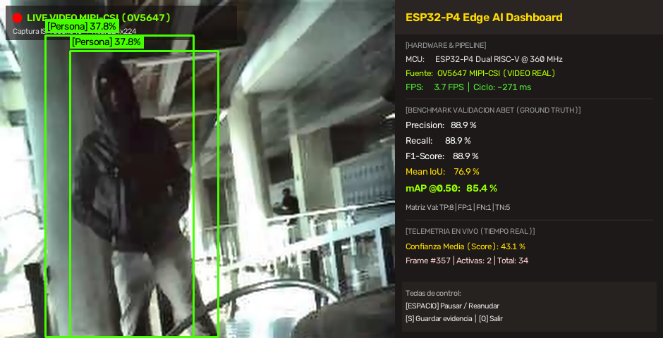

# ESP32-P4 AI Obstacle & Person Detection Pipeline

Este proyecto implementa una red neuronal convolucional para la detección de obstáculos y personas en hardware embebido utilizando el microcontrolador **ESP32-P4** y la biblioteca **ESP-DL** de Espressif. El sistema captura video en vivo de una cámara OV5647 por MIPI-CSI (o, si no hay cámara, usa imágenes guardadas en flash), procesa las inferencias a nivel local y transmite los resultados por comunicación serial a una aplicación cliente en Python para su visualización en PC.

---

## Tabla de Contenidos
1. [Estado del Proyecto: Cámara en Vivo y Modo de Respaldo](#estado-del-proyecto-cámara-en-vivo-y-modo-de-respaldo)
2. [Estructura del Repositorio](#estructura-del-repositorio)
3. [Requisitos de Hardware](#requisitos-de-hardware)
4. [Requisitos de Software](#requisitos-de-software)
5. [Guía de Compilación y Flasheo](#guía-de-compilación-y-flasheo)
6. [Visualización en la PC](#visualización-en-la-pc)
7. [Adquisición del Dataset y Preprocesamiento](#adquisición-del-dataset-y-preprocesamiento)
8. [Cuantización del Modelo (animaciones)](#cuantización-del-modelo)
9. [Intento experimental de video en vivo (`live_video_feed/`)](#intento-experimental-de-video-en-vivo-live_video_feed)

---

## Estado del Proyecto: Cámara en Vivo y Modo de Respaldo

### Historia
El objetivo inicial era detectar objetos en tiempo real con video de una cámara **OV5647 (Raspberry Pi v1.3)** conectada al puerto MIPI-CSI. La biblioteca `esp32-camera` no soporta la interfaz MIPI-CSI del **ESP32-P4**. Además, el primer intento con un driver propio (mayo 2026, carpeta `live_video_feed/`) no logró comunicarse con el sensor. Como plan de contingencia, el firmware procesaba imágenes estáticas guardadas en una partición **SPIFFS**.

### Estado actual (noviembre 2026)
`main/app_main.cpp` del ejemplo `obstacle_person_detect` intenta primero la **cámara en vivo**:
1. Detecta el OV5647 por SCCB (I2C en GPIO 7/8) con el componente `esp_cam_sensor` y ajusta exposición, ganancia y balance de blancos.
2. Captura 800×640 RAW8 por MIPI-CSI. El **ISP por hardware** lo convierte a RGB565 en PSRAM, y el firmware aplica un balance de blancos *gray-world* en punto fijo.
3. Ejecuta la red sobre cada cuadro y envía por UART0, a **921600 baudios**, un JSON con las detecciones, el tiempo de inferencia y una miniatura JPEG de 266×212 en Base64.

Si **no detecta la cámara**, pasa automáticamente al **modo de respaldo**: recorre las 12 imágenes JPEG de 224×224 guardadas en SPIFFS, las decodifica a RGB888, ejecuta la inferencia y envía el mismo JSON (sin miniatura, con tiempos de decodificación e inferencia).

> El modo cámara se integró desde el trabajo de la rama `estandresduran1-patch-1`. No se pudo compilar ni probar en hardware durante la fusión.

## Estructura del Repositorio

Para mantener el proyecto limpio y funcional sin alterar las dependencias relativas de ESP-DL, el repositorio está organizado de la siguiente manera:

```text
Proyecto_Final_IA/
├── README.md                                 # Esta documentación
├── .gitignore                                # Exclusiones para Git (evita subir videos y datasets pesados)
├── COMPILAR_Y_CARGAR_ESP32.bat               # Compila y flashea en Windows (ajuste rutas y puerto)
├── DOCUMENTO_ADELANTO_ABET_2026.md           # Informe de avance ABET (2026-2)
├── Reporte_Proyecto_Vision_Artificial.pdf    # Reporte técnico (mayo 2026)
├── docs/cuantizacion/                        # Animaciones y explicación de la cuantización
├── live_video_feed/                          # Primer intento de video en vivo (experimental, no funcional)
├── Proyecto_Final_IA/
│   ├── README.txt                            # Guía rápida bilingüe de compilación y uso
│   └── esp-dl/                               # Biblioteca Deep Learning de Espressif
│       ├── examples/
│       │   └── obstacle_person_detect/       # [CÓDIGO PROPIO] Aplicación de firmware y visualizadores PC
│       │       ├── main/                     # app_main.cpp (cámara MIPI-CSI + respaldo SPIFFS) e imágenes SPIFFS
│       │       ├── partitions.csv            # Tabla de particiones de memoria flash
│       │       ├── pc_viewer.py              # Visualizador simple con OpenCV (SPIFFS y cámara)
│       │       ├── dashboard_viewer.py       # Dashboard con video, HUD y captura de evidencias
│       │       └── INICIAR_DASHBOARD.bat, build_and_flash.bat/.ps1   # Atajos para Windows
│       └── models/
│           └── obstacle_person_detect/       # [MODELO PROPIO] Binario del modelo .espdl y wrapper C++
└── Vision_Carro_Delivery_dataset_adquisition/# Pipeline de adquisición de datos
    ├── vid2frames.m                          # Script de MATLAB para extracción y redimensionamiento
    ├── Delivery_Vision.v4i.yolov8/           # Metadatos del dataset Roboflow (YOLOv8)
    │   └── data.yaml                         # Configuración del dataset (Clases: obstacle, person)
    └── (Excluidos de Git) /raw_images/       # Fotogramas originales extraídos de los videos MP4
```

---

## Requisitos de Hardware

1. **Microcontrolador**: Tarjeta de desarrollo **Guition JC-ESP32P4-M13 DEV** (módulo `JC-ESP32P4-M3` con chip ESP32-P4, 32MB PSRAM y 16MB Flash).
2. **Cámara**: Cámara compatible con Raspberry Pi 5MP V1.3 (Sensor OV5647, cable plano de 15 pines). Se conecta al puerto MIPI-CSI. Si no se detecta, el firmware usa las imágenes de SPIFFS.
3. **Accesorios**: Cable de conexión USB-C a PC para flasheo y comunicación serial.

---

## Requisitos de Software

* **Espressif ESP-IDF v5.3 o superior**: Entorno oficial de desarrollo necesario para compilar y flashear el microcontrolador (el modo cámara se desarrolló con v5.3.5; el `sdkconfig.defaults.esp32p4` original se generó con v5.4). La primera compilación descarga `esp_cam_sensor` del Component Registry.
* **Python 3.8+**: Requerido en la PC cliente para ejecutar el visualizador.
* **Dependencias de Python**:
  ```cmd
  pip install opencv-python pyserial numpy
  ```

---

## Guía de Compilación y Flasheo

Siga estos pasos para compilar e instalar el firmware en la tarjeta ESP32-P4:

1. Abra su consola con el entorno **ESP-IDF (v5.3+)** activado.
2. Navegue al directorio de la aplicación ejemplo:
   ```bash
   cd Proyecto_Final_IA/esp-dl/examples/obstacle_person_detect
   ```
3. Defina el chip objetivo a compilar:
   ```bash
   idf.py set-target esp32p4
   ```
4. Compile el proyecto y súbalo a la placa conectada:
   ```bash
   idf.py build flash
   ```
   *(Este comando compilará el código C++, empaquetará las imágenes de la carpeta `main/images` en una partición SPIFFS de 1MB y la flasheará automáticamente).*

En Windows también puede usar `build_and_flash.bat` (en la carpeta del ejemplo) o `COMPILAR_Y_CARGAR_ESP32.bat` (en la raíz; ajuste antes las rutas de ESP-IDF y el puerto). Este último solo graba la aplicación en `0x10000`: la primera vez use `idf.py flash` para grabar también la tabla de particiones y la partición SPIFFS.

---

## Visualización en la PC

El firmware cambia la consola UART0 a **921600 baudios**. Antes de abrir un visualizador, **cierre cualquier monitor serial** (incluido `idf.py monitor` o el de VSCode) para liberar el puerto.

### Opción A: `dashboard_viewer.py` (recomendada)
```bash
cd Proyecto_Final_IA/esp-dl/examples/obstacle_person_detect
python dashboard_viewer.py
```
En Windows también se puede usar `INICIAR_DASHBOARD.bat`. El dashboard muestra el video en vivo (o la imagen de SPIFFS), las cajas, los FPS y la latencia. Teclas: `S` guarda una captura en `reportes_metricas/`, `ESPACIO` pausa y `Q` sale.

> **Ojo con las métricas del panel:** el valor de *mAP@0.50* está fijo en el código (`map50 = 0.854`), y los contadores TP/FP/FN/TN y la lista de IoU arrancan con valores predefinidos antes de sumar las detecciones reales. Por eso no son una evaluación independiente del modelo; ver [Lo que falta medir](docs/cuantizacion/README.md#lo-que-falta-medir-en-el-proyecto).

### Evidencias de prueba
[`reportes_metricas/`](Proyecto_Final_IA/esp-dl/examples/obstacle_person_detect/reportes_metricas/) contiene 26 capturas del dashboard tomadas con la cámara OV5647 en vivo. Muestran detecciones de personas y obstáculos a unos **3,7–4 FPS (ciclo de ~250–270 ms**, según el propio panel), un tiempo distinto de los ~106 ms que cita el documento ABET. Las nuevas capturas que se guarden con `S` aparecerán en Git como archivos nuevos.



### Opción B: `pc_viewer.py` (simple)
```bash
cd Proyecto_Final_IA/esp-dl/examples/obstacle_person_detect
python pc_viewer.py            # o: python pc_viewer.py COM3
```
- Si hay un solo puerto serial se usa automáticamente; si hay varios, pide uno (ej. `COM3` o `/dev/ttyACM0`). Con un segundo argumento se cambia la velocidad: `python pc_viewer.py COM3 115200`.
- **Modo cámara:** muestra la miniatura que envía el ESP32 con las cajas reescaladas, de forma continua.
- **Modo SPIFFS:** abre la imagen original de `main/images` y espera una tecla para pasar a la siguiente.
- En consola se imprimen las detecciones y los tiempos medidos en el ESP32-P4. `q` sale.

## Adquisición del Dataset y Preprocesamiento

Los datos del proyecto se capturaron y formatearon mediante el siguiente flujo de trabajo:

1. **Adquisición**: Grabación de videos del entorno del carro repartidor en formato MP4 (`Delivery1.mp4` a `Delivery6.mp4`).
2. **Extracción y Redimensionamiento**: El script de MATLAB `vid2frames.m` extrae automáticamente los fotogramas del video y los redimensiona a **224x224 píxeles** (el tamaño esperado por la capa de entrada de la red neuronal).
3. **Etiquetado y Dataset**: Se cargaron los fotogramas redimensionados en **Roboflow** y se etiquetaron bajo dos categorías:
   * `0: obstacle` (Obstáculo en el camino)
   * `1: person` (Personas)
   * Enlace al Dataset en Roboflow Universe: [Dataset Delivery Vision](https://universe.roboflow.com/nicolass-workspace-qeu9g/delivery_vision/dataset/4)
4. **Quantización**: El modelo entrenado en formato YOLOv8 se convirtió y quantizó en un binario compatible con la arquitectura de aceleración de hardware del ESP32-P4 (`models/obstacle_person_detect/models/p4/espdet_pico_224_224_obstacle_person.espdl`, 577 KB).

---

## Cuantización del Modelo

En [`docs/cuantizacion/`](docs/cuantizacion/README.md) hay 8 animaciones SVG que explican cómo el modelo pasa de float32 a int8 y cómo eso se aplica en este proyecto: exponentes en potencia de 2, calibración, cuantización por canal en el ESP32-P4, una convolución calculada con los pesos reales del `.espdl` y el umbral cuantizado de la salida.


---

## Intento experimental de video en vivo (`live_video_feed/`)

La carpeta [`live_video_feed/`](live_video_feed/) guarda el primer intento (mayo 2026) de capturar video en vivo con la cámara OV5647 por MIPI-CSI. Es un proyecto ESP-IDF independiente: driver propio en `main/mipi_camera.c`, bucle de inferencia en `main/main.cpp` y visualizador en `pc_visualizer/live_feed.py`. Usa el componente del modelo de `Proyecto_Final_IA/esp-dl` mediante rutas relativas.

**Estado:** según su propio registro, [`live_video_feed/README_live.md`](live_video_feed/README_live.md), la cámara **no llegó a funcionar** con este código: hubo timeouts de I2C/SCCB, problemas de reloj, de alimentación y capturas negras. Lo reemplaza el modo cámara del ejemplo principal (ver [Estado del Proyecto](#estado-del-proyecto-cámara-en-vivo-y-modo-de-respaldo)). Se conserva como registro técnico.

```bash
cd live_video_feed
idf.py set-target esp32p4
idf.py build flash
```

El reporte técnico de esa etapa está en [`Reporte_Proyecto_Vision_Artificial.pdf`](Reporte_Proyecto_Vision_Artificial.pdf).
