# Cuantización: qué es y cómo se aplica en este proyecto

Esta carpeta explica, con animaciones, cómo el modelo detector de **obstáculos y personas** pasa de números en coma flotante (float32), con los que se entrenó en el PC, a **enteros de 8 bits (int8)**, que es como corre en el **ESP32-P4**.

Las cifras de las animaciones **no son genéricas**: se leyeron del archivo del modelo de este repositorio,
[`espdet_pico_224_224_obstacle_person.espdl`](../../Proyecto_Final_IA/esp-dl/models/obstacle_person_detect/models/p4/espdet_pico_224_224_obstacle_person.espdl),
con el script [`inspect_espdl.py`](inspect_espdl.py). Cuando algo es ilustrativo (un parche de píxeles, una escena), la animación lo dice.

> Las SVG se animan solas en GitHub y en cualquier navegador. Si el sistema tiene activado "reducir movimiento", se muestra directamente el estado final. Se adaptan al tema claro u oscuro del sistema.

---

## 1. El pipeline y dónde entra la cuantización



El modelo se entrena en float32 con los fotogramas de 224×224 etiquetados en Roboflow. Después se cuantiza **una sola vez en el PC** con ESP-PPQ (cuantización post-entrenamiento, *PTQ*), que es la herramienta que exporta el formato `.espdl`. El ESP32-P4 nunca ve los pesos en float32: recibe enteros int8 y, para cada tensor, un **exponente** `e`.

## 2. Cuantizar es redondear a una rejilla


Cada valor real `x` se guarda como un entero `q` y se reconstruye como `x̂ = q · Δ`:

```
q = clamp( round(x / Δ), -128, 127 )        x̂ = q · Δ
```

Se pierden dos cosas: el **error de redondeo** (como mucho Δ/2) y los valores que quedan **fuera del rango**, que se recortan (saturan). La animación usa 3 bits para que se vea la rejilla; int8 tiene 256 niveles.

## 3. En ESP-DL la escala es una potencia de 2



ESP-DL usa cuantización **simétrica** (sin *zero point*) con `Δ = 2^e`. Así, pasar de una escala a otra es **desplazar bits**, no multiplicar.

- **Entrada de la red**: el tensor `images` tiene `e = −7`. El preprocesado divide el píxel entre 255 (`ImagePreprocessor(m_model, {0,0,0}, {255,255,255})` en `espdet_detect.cpp`) y lo multiplica por 2⁷ = 128. Un píxel de 200 queda como `q = 100`.
- **Entre capas**: en la primera convolución el acumulador tiene `e = −14` y la salida `e = −5`. Basta con `>> 9`.

## 4. Calibración: elegir el exponente


Elegir `e` es un compromiso: si el rango es demasiado estrecho, muchos valores se recortan; si es demasiado ancho, se desperdician niveles y el error de redondeo crece. Con potencias de 2 solo se puede duplicar o dividir a la mitad.

Con los pesos reales del modelo, usar un exponente menos (`e − 1`) recortaría el **10,2 %** de los pesos. Con el `e` elegido, solo el **0,012 %** toca los extremos −128 o 127.

Para las **activaciones**, ESP-PPQ calcula `e` pasando **imágenes de calibración** por el modelo. Para este proyecto conviene calibrar con fotogramas reales del carro (del dataset de Roboflow), no con imágenes genéricas.

## 5. Por canal en el ESP32-P4


Según la documentación de ESP-DL, en el **ESP32-P4** las capas `Conv` y `Gemm` se cuantizan **por canal** (un exponente por filtro) y el resto **por tensor**. El redondeo es `ROUND_HALF_EVEN`.

En la primera capa, 10 de los 16 filtros caben en ±1 y usan `Δ = 2⁻⁷`; los otros 6 necesitan `2⁻⁶`. Con un único exponente, los 16 tendrían el paso más grueso. Esto explica por qué el **bias** de cada canal tiene exponente `e_entrada + e_peso`: −14 o −13 en el archivo.

## 6. Una convolución int8, con los pesos reales



Este es el cálculo que hace el chip para un píxel de salida del filtro 0 de la primera capa:

| paso | valor | exponente |
|---|---|---|
| Σ canal R (9 productos int8 × int8) | 3 696 | −14 |
| + canal G | −883 | −14 |
| + canal B | 30 292 | −14 |
| + bias int32 | −19 914 | −14 |
| **acumulador** | **13 191** (= 0,8051) | −14 |
| `>> 9` con redondeo, ReLU | **26** (= 0,8125) | −5 |

Pesos, bias y exponentes salen del `.espdl`; el parche de píxeles (gris, 180–208) es un ejemplo.

## 7. La salida: el umbral también se cuantiza



La red tiene tres cabezas (strides 8, 16 y 32 → 28×28, 14×14 y 7×7 = 1 029 celdas), con dos clases cada una (`obstacle`, `person`). En `dl_detect_espdet_postprocessor.cpp`, ESP-DL **cuantiza el umbral una sola vez**:

```
score_thr = 0.25  →  logit = ln(0.25/0.75) = −1.0986
stride 8  (score0, e = −3):  −1.0986 · 8 = −8.79 → −9
stride 16/32 (score1/2, e = −2): −1.0986 · 4 = −4.39 → −4
```

Las 2 058 comparaciones se hacen entre enteros. Solo las celdas que superan el umbral se decuantizan (sigmoid y decodificación de la caja). Después se aplican NMS (IoU 0,7, máximo 10 cajas, según `espdet_detect.cpp`) y el JSON que lee `pc_viewer.py`.

## 8. Por qué vale la pena


- **Memoria**: 353 958 parámetros ocuparían 1,42 MB en float32; en int8 (+ bias int32) son **0,37 MB**, 3,8 veces menos. El archivo `.espdl` pesa 0,58 MB porque también guarda el grafo, los nombres y los exponentes por canal.
- **Cómputo**: los registros vectoriales de 128 bits del P4 procesan 16 valores int8 por instrucción, contra 4 float32. Los kernels de ESP-DL para el P4 usan instrucciones como `esp.vmulas.s8.qacc` (ver `esp-dl/dl/base/isa/esp32p4/`).

---

## Lo que falta medir en el proyecto

La cuantización tiene un costo en precisión que **todavía no está medido** en este repositorio. Para cerrarlo se recomienda:

1. Guardar el script de cuantización (ESP-PPQ) y el `.onnx` en float32 usados para generar el `.espdl`.
2. Comparar en el conjunto de validación de Roboflow el **mAP del modelo float32 contra el int8** (ESP-PPQ permite inferir el modelo cuantizado en el PC con `TorchExecutor`).
3. Medir en el chip los tiempos de inferencia: el firmware ya imprime `decode_ms` e `inference_ms` en el JSON.
4. Si la pérdida es grande: calibrar con más fotogramas reales o probar la cuantización mixta/TQT que documenta ESP-DL (`docs/en/tutorials/quantize_model_with_TQT.rst`).

## Reproducir las cifras

```bash
pip install flatbuffers numpy
```

```bash
python docs/cuantizacion/inspect_espdl.py Proyecto_Final_IA/esp-dl/models/obstacle_person_detect/models/p4/espdet_pico_224_224_obstacle_person.espdl
```

El script lee el FlatBuffer según `Proyecto_Final_IA/esp-dl/esp-dl/fbs_loader/espdl.fbs`. Imprime los operadores, el número de parámetros, los exponentes de entrada y salida, el histograma de pesos y el ejemplo de la primera convolución.
